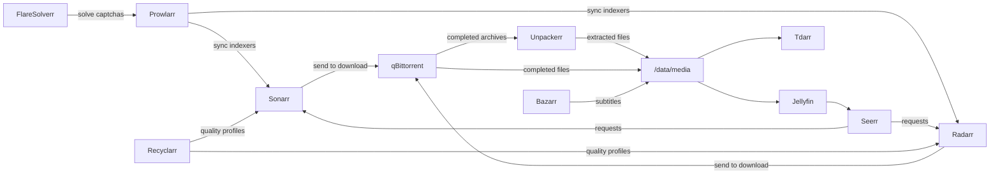

# Applications

The homelab runs an automated media management stack. Most applications are deployed into the `media` namespace via ArgoCD, using the [bjw-s app-template](https://bjw-s-labs.github.io/helm-charts) Helm chart (v5.3.0); Uptime Kuma runs in `monitoring`. Routing is provided by Cilium Gateway API with TLS certificates issued by cert-manager (`letsencrypt-production`).

Authentication is per route: several administrative UIs use the Authentik reverse proxy, while direct routes rely on native application authentication. See [Auth & SSO](../architecture/auth.md) for the route inventory and remaining gaps.

## Shared Configuration

All *arr applications receive common environment variables from the `media-env` ConfigMap:

| Variable | Value |
|----------|-------|
| `TZ` | `America/Chicago` |
| `PUID` | `977` |
| `PGID` | `988` |

Most applications share the `media-data` PersistentVolumeClaim for media and download storage, ensuring a unified `/data` directory structure across the stack.

## Data Flow

The diagram below shows how data moves through the stack, from media requests through downloading and processing to playback.

## Application Summary

Image tags are Renovate-managed and change weekly. The manifests under `k8s/clusters/homelabk8s01/apps/` are the source of truth for the version actually deployed.

| Application | Namespace | URL | Description | Image |
|-------------|-----------|-----|-------------|-------|
| [Jellyfin](jellyfin.md) | `media` | `jellyfin.home.seneker.io` | Media server for movies, TV, and music | `lscr.io/linuxserver/jellyfin` |
| [Sonarr](sonarr.md) | `media` | `sonarr.home.seneker.io` | TV series management and automation | `lscr.io/linuxserver/sonarr` |
| [Radarr](radarr.md) | `media` | `radarr.home.seneker.io` | Movie management and automation | `lscr.io/linuxserver/radarr` |
| [Prowlarr](prowlarr.md) | `media` | `prowlarr.home.seneker.io` | Centralized indexer manager | `lscr.io/linuxserver/prowlarr` |
| [Bazarr](bazarr.md) | `media` | `bazarr.home.seneker.io` | Automated subtitle downloading | `lscr.io/linuxserver/bazarr` |
| [Seerr](seerr.md) | `media` | `seerr.home.seneker.io` | Media request management | `seerr-chart` (own chart) |
| [Downloads](downloads.md) | `media` | `qbit.home.seneker.io` | VPN-routed torrent client (qBittorrent) | `qmcgaw/gluetun`, `lscr.io/linuxserver/qbittorrent` |
| [Recyclarr](recyclarr.md) | `media` | -- | Quality profile sync (CronJob) | `ghcr.io/recyclarr/recyclarr` |
| [Tdarr](tdarr.md) | `media` | `tdarr.home.seneker.io` | Automated media transcoding | `ghcr.io/haveagitgat/tdarr` |
| [Unpackerr](unpackerr.md) | `media` | -- | Automatic extraction of compressed downloads | `ghcr.io/unpackerr/unpackerr` |
| [Exportarr](exportarr.md) | `media` | -- | Prometheus metrics exporter for *arr apps | `ghcr.io/onedr0p/exportarr` |
| [FlareSolverr](flaresolverr.md) | `media` | -- | Captcha-solving proxy for Prowlarr indexers | `ghcr.io/flaresolverr/flaresolverr` |
| [Media Operator](media-operator.md) | `media` | -- | Eight application configurations through seven operators | Media Operator OCI charts |
| [Config Backup](config-backup.md) | `media` | -- | Nightly SQLite/native-archive staging | `python` |
| [Homepage](homepage.md) | `media` | `home.seneker.io` | Dashboard aggregating all services | `ghcr.io/gethomepage/homepage` |
| [Uptime Kuma](uptime-kuma.md) | `monitoring` | `status.home.seneker.io` | Synthetic monitoring and status page | `louislam/uptime-kuma` |
| [Home Assistant](home-assistant.md) | `home-automation` | `ha.home.seneker.io` (after onboarding) | Home automation hub | `ghcr.io/home-operations/home-assistant` |

## Deployment Ordering

Each app is an independent ArgoCD Application with no ordering between them -- see [Infrastructure &rarr; Deployment Ordering](../infrastructure/index.md#deployment-ordering). The `media` namespace, the shared `media-data` PV, and the `media-env` ConfigMap are owned by the `media-prereqs` Application; apps targeting the namespace fail and retry until it exists.
