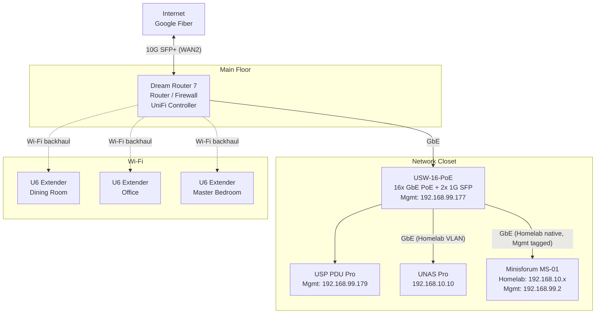
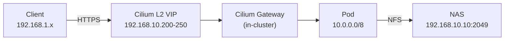

# Network Infrastructure

Physical and logical network architecture below Kubernetes: VLANs, firewall rules, DNS, and remote access. For Kubernetes-level networking (Cilium Gateway API, TLS, network policies, VPN sidecar), see [Networking](networking.md).

## Physical Topology

Links inside the house are Gigabit Ethernet; the internet link is 10G SFP+. See [Hardware Inventory](../reference/hardware.md) for full device specs.

Google Fiber connects to the Dream Router's only SFP+ port, which UniFi names WAN2; WAN1 is fixed to the 2.5G copper Port 4. WAN2, labelled `Google Fiber`, is the weighted WAN with failover priority 1 and a 3 Gbps provider capability. WAN1, labelled `Unused (Port 4)`, is failover-only at priority 2 with nothing connected, so its internet checks always read 0%. The WireGuard server is bound to WAN2.

## VLANs

| VLAN ID | Name | Subnet | Purpose |
|---------|------|--------|---------|
| 1 | Default | 192.168.1.0/24 | Household devices, Wi-Fi clients |
| 10 | Homelab | 192.168.10.0/24 | Proxmox host, Kubernetes VMs, NAS, cluster services |
| 20 | IoT | 192.168.20.0/24 | Smart home devices ([ADR-026](../decisions/026-iot-vlan.md)) |
| 99 | Management | 192.168.99.0/24 | Infrastructure management interfaces (Proxmox, switch, PDU) |

The NAS sits on the Homelab VLAN (192.168.10.10), next to the nodes that mount it: only the homelab uses it, so NFS never crosses the gateway and household devices cannot reach it. The UNAS Pro does not support dual-homing, so its web UI shares that address; a cluster-wide Cilium policy keeps pods off it ([Network Policies](../infrastructure/network-policies.md#infrastructure-administration)).

The MS-01's switch port is a trunk: Homelab (10) as the native VLAN for data traffic, Management (99) tagged for the Proxmox management subinterface, and IoT (20) tagged for the workers' attachment NICs ([ADR-028](../decisions/028-multus-iot-attachments.md)). Default is excluded from it. On the host, `vmbr0` is VLAN-aware: the uplink carries VLANs 1, 20 and 99, the host only 1 and 99, and each VM NIC exactly one VLAN: the untagged native VLAN, or VLAN 20 for a worker's attachment NIC.

### DHCP Scopes

| VLAN | Scope | Notes |
|------|-------|-------|
| Default | 192.168.1.6 -- 192.168.1.254 | Household devices |
| Homelab | 192.168.10.161 -- 192.168.10.190 | Aligned to `192.168.10.160/27` |
| IoT | 192.168.20.100 -- 192.168.20.200 | `.2`--`.99` and `.201`--`.254` left for fixed addresses; `.10`--`.49` are Multus attachments ([ADR-028](../decisions/028-multus-iot-attachments.md)), and `.10` is Home Assistant |
| Management | 192.168.99.6 -- 192.168.99.254 | Switch and PDU take addresses here |

The Homelab scope is deliberately narrow. It sits above the statically addressed infrastructure (`.2` Proxmox, `.50`--`.52` nodes) and below the Cilium LoadBalancer pool (`.200`--`.250`), so DHCP cannot issue an address that collides with a node or a live service VIP. The `/27` boundary is what the Management access firewall rule matches on.

### Wi-Fi Networks

Every SSID is broadcast from all access points.

| SSID | VLAN | Bands | Security |
|------|------|-------|----------|
| Household | Default (1) | 2.4 / 5 / 6 GHz | WPA2/WPA3 transition |
| Homelab | Homelab (10) | 2.4 / 5 / 6 GHz | WPA2/WPA3 transition |
| IoT | IoT (20) | 2.4 GHz only | WPA2 only |

The IoT SSID uses the settings older smart-device radios need, so the household SSID keeps WPA3 and 5/6 GHz. See [ADR-026](../decisions/026-iot-vlan.md).

### Switch Port Assignments

USW-16-PoE, from the switch MAC forwarding table and port configuration:

| Port | Device | VLAN |
|------|--------|------|
| 1 | Uplink to Dream Router 7 | Trunk |
| 2 | MS-01 `nic0` | Native Homelab (10), tagged Management (99) and IoT (20); Default excluded |
| 4 | MS-01 `nic1` (Intel AMT) | Native Management (99); tagged VLANs blocked |
| 5 | USP PDU Pro | Management (99) |
| 7 | UNAS Pro | Homelab (10) |

Port 2 carries both the Proxmox host and every Kubernetes VM, since the VMs bridge onto `vmbr0`. A cable in the wrong port therefore takes the entire cluster off the Homelab VLAN while leaving the host running -- the machine stays up and reachable from its own console, but nothing on the network can see it.

## Firewall Rules

Configured in the UniFi Network controller on the Dream Router 7. Rules are evaluated in order.

### Zone Defaults

The Management, Homelab and IoT zones block all traffic to and from other zones by default (except External and Gateway). This provides isolation without explicit deny rules.

### Custom Rules

| # | Source | Destination | Action | Purpose |
|---|--------|-------------|--------|---------|
| 1 | Internal | Homelab | Allow | Home network access to homelab services |
| 2 | Homelab -- 192.168.10.160/27 | Management | Allow | Workstation access to management interfaces |
| 3 | Vpn | Management | Allow | Remote management over WireGuard/Teleport |
| 4 | Vpn | Homelab | Allow | Remote access to cluster services over WireGuard/Teleport |
| 5 | Internal | IoT | Allow | Household control of smart home devices |
| 6 | Vpn | Internal | Allow | Remote access to household devices over WireGuard/Teleport |
| 7 | IoT | Gateway -- all TCP/UDP except 53, 67, 123, 5353 | Block | IoT devices reach the gateway only for DNS, DHCP, NTP and mDNS |
| 8 | Homelab, except 192.168.10.160/27 | Gateway -- all TCP/UDP except 53, 67, 123, 5353 (IPv4) | Block | Nodes, the Proxmox host and pod traffic stay off the UniFi console and SSH |
| 9 | Homelab | Gateway -- all TCP/UDP except 53, 67, 123, 5353 (IPv6) | Block | The same over IPv6 link-local |
| 10 | Internal | Gateway -- TCP 22 | Block | Household clients keep the web console; gateway SSH is for the workstation block and VPN |
| 11 | Internal | Homelab, except 192.168.10.201 | Block | Household clients reach only the gateway VIP |
| 12 | Internal | Homelab -- 192.168.10.201, all TCP/UDP except 80, 443 | Block | The gateway VIP serves HTTP and HTTPS only |
| 13 | Internal | IoT -- 192.168.20.10 (Home Assistant) | Block | Household clients reach Home Assistant at `ha.home.seneker.io` through the gateway, never its IoT address |
| 14 | Homelab -- 192.168.10.50 -- .52 (nodes) | Gateway -- 192.168.10.1, TCP 443 | Allow | unpoller reads the UniFi controller ([ADR-033](../decisions/033-network-monitoring.md)) |
| 15 | Homelab -- 192.168.10.10 (NAS), UDP source ports 5353, 10001 | Gateway -- 192.168.10.1 | Allow | The NAS answers the gateway's UniFi device discovery and mDNS queries |
| 16 | IoT -- 192.168.20.10 (Home Assistant), UDP source port 5353 | Gateway -- 192.168.20.1 | Allow | Home Assistant answers the mDNS proxy's one-shot queries |

Rules 7 -- 12 match only new connections, so replies to traffic in the other direction are unaffected. Rules 7 -- 10 leave ICMP allowed. They implement the console boundary in [ADR-016](../decisions/016-vlan-segmentation.md#firewall-rules) and [ADR-026](../decisions/026-iot-vlan.md).

Rule 14 is evaluated ahead of rule 8, so the nodes reach the console's HTTPS port on 192.168.10.1 and nothing else beyond rule 8's services; the console's other addresses and port 80 stay blocked. Pod traffic leaves the cluster from node addresses, so the `deny-gateway-console` Cilium policy keeps every pod except unpoller off it ([unpoller](../infrastructure/unpoller.md#access-to-the-console)).

Rule 16 is evaluated ahead of rule 7. The mDNS proxy relays household devices' searches onto the IoT VLAN as one-shot queries from a random port, which ask the answer to come straight back to that port; rule 7 permits only the gateway's service ports, so it would block Home Assistant's reply. Household devices still reach Home Assistant only through `ha.home.seneker.io` (rule 13).

Rule 15 is also evaluated ahead of rule 8. The gateway broadcasts UniFi device discovery on every network, and the NAS, a UniFi OS console, answers from UDP 10001; it also answers the gateway's one-shot mDNS queries from UDP 5353. A reply to a broadcast or multicast has no connection-tracking entry, so without rule 15 rule 8 treats each one as a new connection and blocks it.

The extenders' management addresses are on the Default VLAN, but they also bridge VLAN 10 for the Homelab SSID. They hear the NAS's own discovery broadcasts there and answer from UDP 10001 through the gateway, so rule 11 blocks those replies as new household-to-Homelab connections. The household-to-NAS boundary stays closed. With the extenders' management on the Management VLAN the replies would continue, but as infrastructure-to-infrastructure traffic that a rule could allow without opening the household side.

Rule 13 is evaluated ahead of rule 5, so no household browser or app sends Home Assistant credentials in plaintext over VLAN 20. Rule 5 is one-way. The IoT zone default only returns traffic to Internal, so smart devices cannot open connections into the household network, the cluster and the NAS, or Management. Nothing permits Homelab, Management or Vpn into IoT.

Within Internal -> Homelab, the order is rules 11, 12, then 1. Rules 11 and 12 refuse new household connections anywhere except the gateway VIP on 80 and 443, so rule 1 carries only those and the replies to connections Homelab starts. Administration happens from the Homelab Wi-Fi or the VPN. The limit uses block rules because an allow rule restricted by address and port did not match traffic in this zone pair. UniFi appends new policies to the end of a zone pair, so the order is set explicitly, through the Integration API (`firewall/policies/ordering`) or the UI.

The NAS shares the Homelab VLAN with the nodes, so NFS never reaches the firewall, including the NFSv3 lock grants and reboot notifications the NAS opens back to the nodes on dynamic ports. Rule 2 is scoped rather than zone-wide: it permits only the Homelab DHCP block, which excludes the Proxmox host and the Kubernetes nodes -- neither the hypervisor nor pod traffic masquerading behind a node IP can reach the Management VLAN. Each node's NIC carries a Proxmox anti-spoofing filter, so a node can send only from its own address and the Cilium L2 pool, never from a workstation-block address ([ADR-016](../decisions/016-vlan-segmentation.md#hypervisor-enforcement)). The host's bridge filters VLANs and each node NIC is an access port on the native VLAN, so a node cannot reach the Management VLAN at Layer 2 either; rule 2's boundary holds below the firewall.

Scoping rule 2 to the DHCP block rather than a single address is deliberate. The workstation uses a rotating private Wi-Fi address, so a MAC-pinned reservation or single-IP rule stops matching whenever the address rotates. Any address the workstation can be issued falls inside the block.

There is no explicit deny into Management. Isolation comes from the zone defaults above, so any source not listed here is refused.

Management VLAN outbound to External and Gateway is allowed by zone defaults (for updates, NTP).

### Proxmox Host Firewall

The nodes and the host share 192.168.10.0/24, so the zone firewall never sees traffic between them. The host firewall covers that path ([ADR-016](../decisions/016-vlan-segmentation.md#proxmox-host-firewall)):

| Port | Service | Allowed from |
|------|---------|--------------|
| 22, 8006, 3128 | SSH, web UI and API, SPICE proxy | `management` set: 192.168.10.160/27, 192.168.3.0/24, 192.168.99.0/24 |
| 3493, 9100 | NUT, node-exporter | Nodes 192.168.10.50 -- .52, which pod traffic is masqueraded behind |
| ICMP | Ping | Anywhere |

Everything else, rpcbind (111) included, is dropped. `local_network` is set to 192.168.99.0/24, because Proxmox adds it to the `management` set and would otherwise detect the whole Homelab VLAN.

### Management Access

Tested 2026-11-21, the NAS rows again after its move on 2026-11-22 and the gateway rows after rule 14 the same day, from the workstation (192.168.10.160/27), node-2 and a pod in a namespace without network policies:

| Endpoint | Workstation | Node | Pod |
|----------|-------------|------|-----|
| Proxmox 192.168.10.2: SSH, web UI, SPICE, rpcbind | Open | Refused | Refused |
| Proxmox 192.168.10.2: NUT 3493, node-exporter 9100 | Open | Open | Open |
| Management VLAN: Proxmox 192.168.99.2, AMT, switch and PDU SSH | Open | Refused | Refused |
| Gateway web console 192.168.10.1:443 | Open | **Open** | Refused; only unpoller in `monitoring` |
| Gateway web consoles 192.168.1.1, .99.1, and port 80 | Open | Refused | Refused |
| NAS 192.168.10.10: web UI 80, 443 | Open | **Open** | Refused |
| NAS 192.168.10.10: NFS 2049 | Open | Open | Open |

The switch and PDU have no local web UI, and SSH is off on the NAS and the gateway. Pods are refused by the host firewall, the zone firewall and the cluster-wide Cilium policy ([Network Policies](../infrastructure/network-policies.md#infrastructure-administration)). The nodes share the NAS's VLAN and reach its web UI at Layer 2, because the UNAS Pro has no host firewall. Rule 11 keeps household devices off it.

## DNS

The UniFi Network controller's local DNS holds three records, all under `home.seneker.io` ([ADR-030](../decisions/030-public-domain-and-certificates.md)):

| Record | Address | Purpose |
|--------|---------|---------|
| `*.home.seneker.io` | 192.168.10.201 | Every service behind the Cilium Gateway |
| `home.seneker.io` | 192.168.10.201 | Homepage; a wildcard does not match the bare name |
| `proxmox.home.seneker.io` | 192.168.10.2 | The Proxmox host |

New services need no DNS change: an HTTPRoute on the Gateway is enough. The Gateway pins 192.168.10.201 with `spec.addresses` ([Cilium Gateway](../infrastructure/cilium-gateway.md#gateway)). The more specific `proxmox` record takes precedence over the wildcard. The records have a 300-second TTL, but the gateway answers wildcard matches with TTL 0 whatever the record says, so service names are never cached and stop resolving while the router reboots. The gateway applies record changes a few seconds after they are saved.

`seneker.io` is a public domain in Route 53, but `home.seneker.io` names exist only in these local records; public DNS returns nothing for them. The public zone carries only the ACME challenge record and deliberately public sites.

See [Networking - Application Hostnames](networking.md#application-hostnames) for the full hostname list.

### Multicast DNS

The gateway's mDNS proxy runs in automatic mode with all predefined services enabled (AirPlay, Chromecast, HomeKit, Matter and others). It forwards only on Default and IoT, so household clients discover services advertised on the IoT VLAN and nothing is reflected into Homelab or Management. The scope is each network's mDNS forwarding flag (`mdnsForwardingEnabled` in the Integration API's network object); the site-level `mdns` setting's network list does not control it. Matter is the exception: its controller needs an interface on the devices' VLAN rather than the proxy; see [ADR-026](../decisions/026-iot-vlan.md#consequences).

## Remote Access

| Method | Status | Reaches |
|--------|--------|---------|
| WireGuard VPN | Server enabled on Dream Router 7, bound to WAN2, `192.168.3.0/24` | Homelab, Management and Default |
| UniFi Teleport | Enabled | Homelab, Management and Default |

Both land in the `Vpn` firewall zone, which rules 3, 4 and 6 above permit into Homelab, Management and Internal. A VPN client therefore reaches cluster services and the NAS, the Proxmox web UI on either interface, the switch and PDU management pages, and household devices. The IoT VLAN is not reachable over the VPN.

There is no inbound path from the internet: no port forwards, no static routes, no reverse proxy. The `home.seneker.io` records exist only in UniFi's local DNS and resolve to private addresses, so remote access requires the VPN.

## Kubernetes Network Integration

How the physical network connects to the Kubernetes pod network:

| Network | CIDR | Purpose |
|---------|------|---------|
| Default VLAN | 192.168.1.0/24 | Client access |
| Homelab VLAN | 192.168.10.0/24 | Node IPs, NAS, Cilium L2 VIPs |
| Management VLAN | 192.168.99.0/24 | Infrastructure management (not used by Kubernetes) |
| Pod network | 10.0.0.0/8 | Kubernetes pod CIDR (Cilium cluster-pool, /24 per node) |
| Service network | 10.96.0.0/12 | Kubernetes service CIDR |
| L2 VIP pool | 192.168.10.200-250 | Cilium LoadBalancer IPs |
