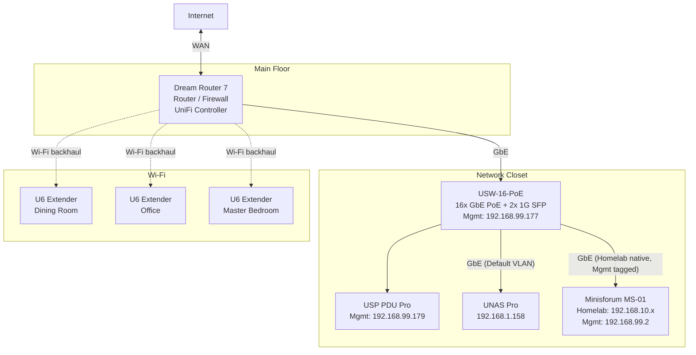
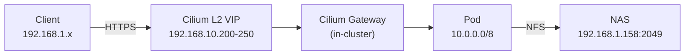

# Network Infrastructure

Physical and logical network architecture below Kubernetes: VLANs, firewall rules, DNS, and remote access. For Kubernetes-level networking (Cilium Gateway API, TLS, network policies, VPN sidecar), see [Networking](networking.md).

## Physical Topology

All physical links are Gigabit Ethernet. See [Hardware Inventory](../reference/hardware.md) for full device specs.

## VLANs

| VLAN ID | Name | Subnet | Purpose |
|---------|------|--------|---------|
| 1 | Default | 192.168.1.0/24 | Household devices, NAS data plane, Wi-Fi clients |
| 10 | Homelab | 192.168.10.0/24 | Proxmox host, Kubernetes VMs, cluster services |
| 20 | IoT | 192.168.20.0/24 | Smart home devices ([ADR-026](../decisions/026-iot-vlan.md)) |
| 99 | Management | 192.168.99.0/24 | Infrastructure management interfaces (Proxmox, switch, PDU) |

The NAS sits on the Default VLAN (192.168.1.158) because it serves both household devices and the Kubernetes cluster. The UNAS Pro does not support dual-homing, so its management interface remains on the Default VLAN.

The MS-01's switch port is a trunk: Homelab (10) as the native VLAN for data traffic, Management (99) tagged for the Proxmox management subinterface, and IoT (20) tagged for the workers' attachment NICs ([ADR-028](../decisions/028-multus-iot-attachments.md)). Default is excluded from it. On the host, `vmbr0` is VLAN-aware: the uplink carries VLANs 1, 20 and 99, the host only 1 and 99, and each VM NIC exactly one VLAN: the untagged native VLAN, or VLAN 20 for a worker's attachment NIC.

### DHCP Scopes

| VLAN | Scope | Notes |
|------|-------|-------|
| Default | 192.168.1.6 -- 192.168.1.254 | Household devices |
| Homelab | 192.168.10.161 -- 192.168.10.190 | Aligned to `192.168.10.160/27` |
| IoT | 192.168.20.100 -- 192.168.20.200 | `.2`--`.99` and `.201`--`.254` left for fixed addresses |
| Management | 192.168.99.6 -- 192.168.99.254 | Switch and PDU take addresses here |

The Homelab scope is deliberately narrow. It sits above the statically addressed infrastructure (`.2` Proxmox, `.50`--`.52` nodes) and below the Cilium LoadBalancer pool (`.200`--`.250`), so DHCP cannot issue an address that collides with a node or a live service VIP. The `/27` boundary is what the Management access firewall rule matches on.

### Wi-Fi Networks

Every SSID is broadcast from all access points.

| SSID | VLAN | Bands | Security |
|------|------|-------|----------|
| Household | Default (1) | 2.4 / 5 / 6 GHz | WPA2/WPA3 transition |
| Homelab | Homelab (10) | 2.4 / 5 / 6 GHz | WPA2/WPA3 transition |
| IoT | IoT (20) | 2.4 GHz only | WPA2 only |

The IoT SSID uses the settings older smart-device radios need, so the household SSID keeps WPA3 and 5/6 GHz. See [ADR-026](../decisions/026-iot-vlan.md).

### Switch Port Assignments

USW-16-PoE, from the switch MAC forwarding table and port configuration:

| Port | Device | VLAN |
|------|--------|------|
| 1 | Uplink to Dream Router 7 | Trunk |
| 2 | MS-01 `nic0` | Native Homelab (10), tagged Management (99) and IoT (20); Default excluded |
| 4 | Reserved for out-of-band management | Native Management (99) |
| 5 | USP PDU Pro | Management (99) |
| 7 | UNAS Pro | Default (1) |

Port 2 carries both the Proxmox host and every Kubernetes VM, since the VMs bridge onto `vmbr0`. A cable in the wrong port therefore takes the entire cluster off the Homelab VLAN while leaving the host running -- the machine stays up and reachable from its own console, but nothing on the network can see it.

## Firewall Rules

Configured in the UniFi Network controller on the Dream Router 7. Rules are evaluated in order.

### Zone Defaults

The Management, Homelab and IoT zones block all traffic to and from other zones by default (except External and Gateway). This provides isolation without explicit deny rules.

### Custom Rules

| # | Source | Destination | Action | Purpose |
|---|--------|-------------|--------|---------|
| 1 | Internal | Homelab | Allow | Home network access to homelab services |
| 2 | Homelab | Internal -- 192.168.1.158 (NAS) | Allow, with return | Kubernetes NFS access to NAS |
| 3 | Homelab -- 192.168.10.160/27 | Management | Allow | Workstation access to management interfaces |
| 4 | Vpn | Management | Allow | Remote management over WireGuard/Teleport |
| 5 | Vpn | Homelab | Allow | Remote access to cluster services over WireGuard/Teleport |
| 6 | Internal | IoT | Allow | Household control of smart home devices |
| 7 | Vpn | Internal | Allow | Remote access to household devices and the NAS over WireGuard/Teleport |
| 8 | IoT | Gateway -- all TCP/UDP except 53, 67, 123, 5353 | Block | IoT devices reach the gateway only for DNS, DHCP, NTP and mDNS |
| 9 | Homelab, except 192.168.10.160/27 | Gateway -- all TCP/UDP except 53, 67, 123, 5353 (IPv4) | Block | Nodes, the Proxmox host and pod traffic stay off the UniFi console and SSH |
| 10 | Homelab | Gateway -- all TCP/UDP except 53, 67, 123, 5353 (IPv6) | Block | The same over IPv6 link-local |
| 11 | Internal | Gateway -- TCP 22 | Block | Household clients keep the web console; gateway SSH is for the workstation block and VPN |
| 12 | Internal -- 192.168.1.158 (NAS) | Homelab -- 192.168.10.50 -- .52 (nodes) | Allow | NFSv3 lock callbacks from the NAS |
| 13 | Internal, except 192.168.1.158 (NAS) | Homelab, except 192.168.10.201 | Block | Household clients reach only the gateway VIP |
| 14 | Internal | Homelab -- 192.168.10.201, all TCP/UDP except 80, 443 | Block | The gateway VIP serves HTTP and HTTPS only |

Rules 8 -- 11, 13 and 14 match only new connections, so replies to traffic in the other direction are unaffected. Rules 8 -- 11 leave ICMP allowed. They implement the console boundary in [ADR-016](../decisions/016-vlan-segmentation.md#firewall-rules) and [ADR-026](../decisions/026-iot-vlan.md).

Rule 6 is one-way. The IoT zone default only returns traffic to Internal, so smart devices cannot open connections into the household network, the NAS, the cluster or Management. Nothing permits Homelab, Management or Vpn into IoT.

Within Internal -> Homelab, the order is rules 12, 13, 14, then 1. Rules 13 and 14 refuse new household connections anywhere except the gateway VIP on 80 and 443, so rule 1 carries only those and the replies to connections Homelab starts. Administration happens from the Homelab Wi-Fi or the VPN. The limit uses block rules because an allow rule restricted by address and port did not match traffic in this zone pair. UniFi appends new policies to the end of a zone pair, so the order is set explicitly, through the Integration API (`firewall/policies/ordering`) or the UI. Rule 13 also excludes the NAS, so the NFS lock callbacks in rule 12 do not depend on that order.

Rules 2 and 3 are scoped rather than zone-wide. Rule 2 permits only the NAS IP, so Homelab devices cannot reach other Default VLAN hosts. It generates the return policy that carries the NAS's NFS replies. The NFS mounts are NFSv3 with server-side locking, so the NAS also opens connections back to the nodes for lock grants and reboot notifications, on dynamic ports; rule 12 permits exactly that. Rule 3 permits only the Homelab DHCP block, which excludes the Proxmox host and the Kubernetes nodes -- neither the hypervisor nor pod traffic masquerading behind a node IP can reach the Management VLAN. Each node's NIC carries a Proxmox anti-spoofing filter, so a node can send only from its own address and the Cilium L2 pool, never from a workstation-block address ([ADR-016](../decisions/016-vlan-segmentation.md#hypervisor-enforcement)). The host's bridge filters VLANs and each node NIC is an access port on the native VLAN, so a node cannot reach the Management VLAN at Layer 2 either; rule 3's boundary holds below the firewall.

Scoping rule 3 to the DHCP block rather than a single address is deliberate. The workstation uses a rotating private Wi-Fi address, so a MAC-pinned reservation or single-IP rule stops matching whenever the address rotates. Any address the workstation can be issued falls inside the block.

There is no explicit deny into Management. Isolation comes from the zone defaults above, so any source not listed here is refused.

Management VLAN outbound to External and Gateway is allowed by zone defaults (for updates, NTP).

## DNS

Static entries for each service are configured in the UniFi Network controller's local DNS records, pointing to the Cilium L2 gateway VIP. Services use `*.home.seneker.io` names ([ADR-030](../decisions/030-public-domain-and-certificates.md)). The `homelab.local` records stay until those names are retired.

`seneker.io` is a public domain in Route 53, but `home.seneker.io` names exist only in these local records; public DNS returns nothing for them. The public zone carries only the ACME challenge record and deliberately public sites.

See [Networking - Application Hostnames](networking.md#application-hostnames) for the full hostname list.

### Multicast DNS

The gateway's mDNS proxy runs in automatic mode with all predefined services enabled (AirPlay, Chromecast, HomeKit, Matter and others). It forwards only on Default and IoT, so household clients discover services advertised on the IoT VLAN and nothing is reflected into Homelab or Management. The scope is each network's mDNS forwarding flag (`mdnsForwardingEnabled` in the Integration API's network object); the site-level `mdns` setting's network list does not control it. Matter is the exception: its controller needs an interface on the devices' VLAN rather than the proxy; see [ADR-026](../decisions/026-iot-vlan.md#consequences).

## Remote Access

| Method | Status | Reaches |
|--------|--------|---------|
| WireGuard VPN | Server enabled on Dream Router 7, `192.168.3.0/24` | Homelab, Management and Default |
| UniFi Teleport | Enabled | Homelab, Management and Default |

Both land in the `Vpn` firewall zone, which rules 4, 5 and 7 above permit into Homelab, Management and Internal. A VPN client therefore reaches cluster services, the Proxmox web UI on either interface, the switch and PDU management pages, and household devices including the NAS. The IoT VLAN is not reachable over the VPN.

There is no inbound path from the internet: no port forwards, no static routes, no reverse proxy. All `*.homelab.local` records resolve to a private address, so remote access requires the VPN.

## Kubernetes Network Integration

How the physical network connects to the Kubernetes pod network:

| Network | CIDR | Purpose |
|---------|------|---------|
| Default VLAN | 192.168.1.0/24 | Client access, NAS data plane |
| Homelab VLAN | 192.168.10.0/24 | Node IPs, Cilium L2 VIPs |
| Management VLAN | 192.168.99.0/24 | Infrastructure management (not used by Kubernetes) |
| Pod network | 10.0.0.0/8 | Kubernetes pod CIDR (Cilium cluster-pool, /24 per node) |
| Service network | 10.96.0.0/12 | Kubernetes service CIDR |
| L2 VIP pool | 192.168.10.200-250 | Cilium LoadBalancer IPs |
