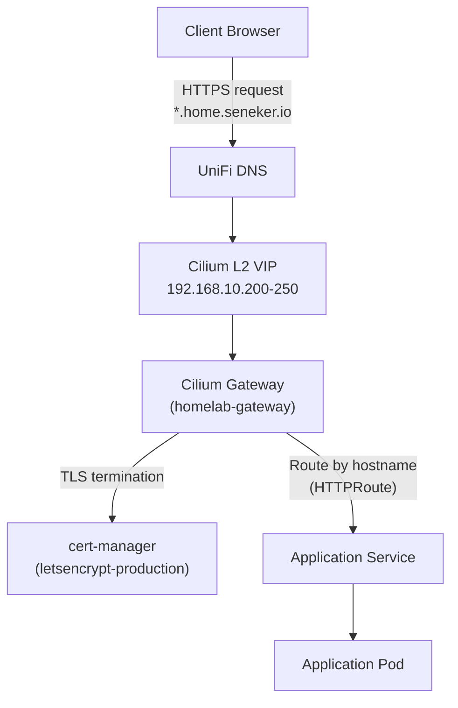
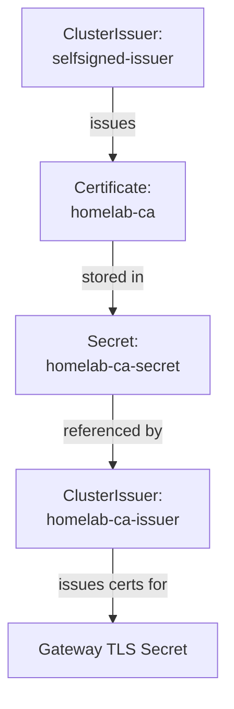
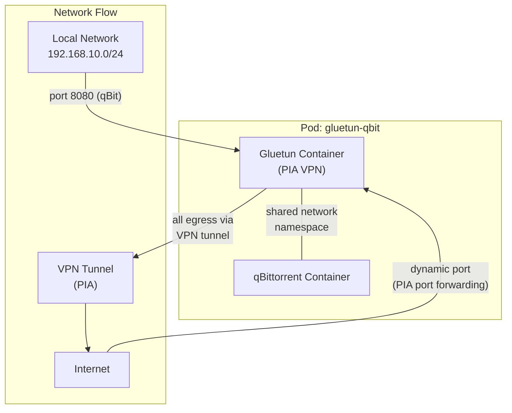

# Networking

This document covers the networking stack from external client access down to individual pods, including load balancing, gateway routing, TLS termination, DNS, and the VPN sidecar architecture.

## Network Architecture



## Cilium Gateway API

Cilium serves as both the CNI and the gateway controller. The `homelab-gateway` Gateway accepts HTTPS on port 443 through two listeners, each terminating TLS with its own wildcard certificate:

| Listener | Hostnames | Certificate |
|----------|-----------|-------------|
| `https-home` | `*.home.seneker.io` | `home-gateway-tls`, from Let's Encrypt |
| `https` | `*.homelab.local` | `homelab-gateway-tls`, from the homelab CA |

Services use their `home.seneker.io` names, which every device trusts without extra setup. The `homelab.local` names are being retired. Routes that still list one serve both names, and the old names of SSO-protected apps redirect to the new ones (`gateway/homelab-local-redirects.yml`).

Each application defines an HTTPRoute that binds to the gateway and routes by hostname:

```yaml
route:
  main:
    enabled: true
    kind: HTTPRoute
    parentRefs:
      - group: gateway.networking.k8s.io
        kind: Gateway
        name: homelab-gateway
        namespace: default
        sectionName: https-home
    hostnames:
      - <app>.home.seneker.io
```

An HTTP-to-HTTPS redirect is configured via a separate HTTPRoute on the gateway's `http` and `http-home` listeners.

### Key Resources

| Resource | Kind | Purpose |
|----------|------|---------|
| `homelab-gateway` | Gateway | Central entry point for all HTTPS traffic |
| `homelab-pool` | CiliumLoadBalancerIPPool | Allocates IPs from `192.168.10.200-250` |
| `homelab-l2` | CiliumL2AnnouncementPolicy | Advertises allocated IPs via ARP on the LAN |
| Per-app routes | HTTPRoute | Hostname-based routing to each application service |

## Cilium L2 Announcements

Cilium replaces MetalLB for LoadBalancer IP allocation. It operates in Layer 2 mode, responding to ARP requests on the local network to advertise virtual IPs from the `homelab-pool`.

- **IP Address Pool:** `192.168.10.200` - `192.168.10.250`
- **Mode:** L2 ARP announcement
- **Consumers:** The `homelab-gateway` Gateway and any LoadBalancer services (e.g., Jellyfin)

!!! note "L2 Limitations"
    In L2 mode, all traffic for a given VIP is handled by a single node (the current ARP responder). Failover occurs when the node becomes unavailable, at which point another node takes over the VIP.

## Gateway Certificates

`gateway/certificates.yml` declares both gateway certificates explicitly. See [cert-manager](../infrastructure/cert-manager.md) for the issuers.

- **`home-gateway-tls`** covers `*.home.seneker.io`. The `letsencrypt-production` ClusterIssuer obtains it with an ACME DNS-01 challenge in Route 53. cert-manager's AWS credentials can change only the `_acme-challenge.home.seneker.io` TXT record, so the public zone never holds a service address.
- **`homelab-gateway-tls`** covers `*.homelab.local` and is signed by the in-cluster CA chain below.



### CA Chain Components

| Resource | Kind | Purpose |
|----------|------|---------|
| `selfsigned-issuer` | ClusterIssuer | Bootstrap issuer that signs the CA certificate |
| `homelab-ca` | Certificate | The root CA certificate, signed by the self-signed issuer |
| `homelab-ca-secret` | Secret | Stores the CA key pair, referenced by the CA issuer |
| `homelab-ca-issuer` | ClusterIssuer | Issues `homelab-gateway-tls` |

!!! tip "Trusting the CA"
    Only the `homelab.local` names need the homelab CA. To avoid browser warnings on them, import the `homelab-ca` certificate into your operating system or browser trust store, as described in [Trusting the CA](../getting-started/trust-ca.md).

## DNS

Service names resolve only on the home network and the VPN. The UniFi gateway holds one A record per hostname, pointing to the Cilium L2 VIP assigned to `homelab-gateway`. Public DNS for `home.seneker.io` holds no host records, so the names do not resolve anywhere else. Add a UniFi record with each new route.

### Application Hostnames

| Application | Hostname |
|------------|----------|
| Jellyfin | `jellyfin.home.seneker.io` |
| Sonarr | `sonarr.home.seneker.io` |
| Radarr | `radarr.home.seneker.io` |
| Prowlarr | `prowlarr.home.seneker.io` |
| Bazarr | `bazarr.home.seneker.io` |
| Seerr | `seerr.home.seneker.io` |
| qBittorrent | `qbit.home.seneker.io` |
| Tdarr | `tdarr.home.seneker.io` |
| Homepage | `dash.home.seneker.io` |
| Uptime Kuma | `status.home.seneker.io` |
| Authentik | `auth.home.seneker.io` |
| Grafana | `grafana.home.seneker.io` |
| Prometheus | `prometheus.home.seneker.io` |
| Alertmanager | `alertmanager.home.seneker.io` |
| Vault | `vault.home.seneker.io` |
| Goldilocks | `goldilocks.home.seneker.io` |
| ArgoCD | `argocd.home.seneker.io` |

## Network Policies

CiliumNetworkPolicies enforce ingress and egress isolation in the namespaces that have policies. Rules explicitly allow the gateway, same-namespace traffic and required cross-namespace paths; coverage is not universal. See the [Network Policies infrastructure page](../infrastructure/network-policies.md) for the full policy breakdown per namespace.

!!! warning "Policy coverage and management-network boundaries"
    Selected namespaces use an implicit egress-deny model with explicit DNS, API, NFS and application exceptions. Some exceptions still allow `world` on HTTPS or broad cluster access, and namespaces without policies remain unrestricted. This does not substitute for firewall isolation of Proxmox and NAS management. Verify positive and negative connection tests before tightening those boundaries.

## VPN Sidecar Architecture

qBittorrent runs alongside a Gluetun VPN container in a shared pod. Both containers share a single network namespace, meaning all egress traffic from qBittorrent routes through the VPN tunnel.



### Gluetun Configuration

| Setting | Value |
|---------|-------|
| VPN Provider | Private Internet Access (PIA) |
| Server Region | CA Montreal |
| Capability | `NET_ADMIN` (required for VPN tunnel creation) |
| Firewall - qBittorrent | Port 8080 |
| Port Forwarding | `VPN_PORT_FORWARDING=on` (PIA assigns port dynamically) |
| Credentials | ExternalSecret (`vpn-credentials`, synced from Vault) |

Gluetun creates the VPN tunnel interface and configures iptables firewall rules. The `NET_ADMIN` capability is required for tunnel and firewall management. Because the containers share a network namespace, qBittorrent automatically uses the VPN tunnel for all outbound connections.

!!! warning "Kill Switch"
    If the VPN tunnel drops, Gluetun's built-in firewall rules prevent any traffic from leaving the pod outside the tunnel. This acts as a kill switch ensuring download traffic is never exposed on the local network.
