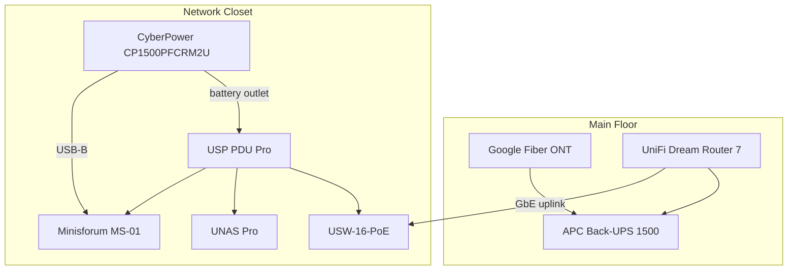

# Hardware Inventory

Physical hardware that makes up the homelab.

## Rack

### StarTech RK15WALLOA

Wall-mounted in a network closet. All equipment except the Dream Router 7 is installed here.

| Spec | Detail |
|------|--------|
| Model | RK15WALLOA |
| Type | 19" open-frame, 2-post wall-mount |
| Rack units | 15U |
| Depth | Adjustable 12-20" |
| Weight capacity | 198 lb (90 kg) |
| Material | SPCC cold-rolled steel |

## Rack Layout

The Dream Router 7 sits on the main floor and connects to the closet via a single Gigabit Ethernet uplink.

## Compute

### Minisforum MS-01 (homelabpve01)

Proxmox VE hypervisor. Runs all Kubernetes VMs.

| Spec | Detail |
|------|--------|
| Model | MS-01-S1390 (barebones) |
| CPU | Intel Core i9-13900H (6P+8E / 20T, up to 5.4 GHz, vPro Enterprise); core 12 isolated, 18 threads scheduled, capped at 5.2 GHz |
| RAM | Crucial CT2K32G52S42U5 (2x32 GB DDR5-5200 SO-DIMM, dual-channel) |
| Storage | WD Black SN850X 2TB NVMe (PCIe 4.0 x4, M.2 2280 slot 1) |
| iGPU | Intel Iris Xe (i915, PCI 0000:00:02.0, passed through to K8s via VFIO) |
| NICs | 2x Intel X710 10G SFP+, 1x Intel I226-V 2.5G RJ45 (nic0), 1x Intel I226-LM 2.5G RJ45 (nic1, vPro/AMT) |
| Expansion | 1x PCIe 4.0 x16 (half-height single-slot), 2x M.2 NVMe (slot 2: PCIe 3.0 x4, slot 3: PCIe 3.0 x2) |
| Other I/O | 2x USB4 (40 Gbps), 3x USB 3.2, 2x USB 2.0, HDMI 2.0 |
| Wireless | Intel AX211 (Wi-Fi 6E + Bluetooth 5.2) -- unused |
| Management | Intel AMT (vPro Enterprise) -- static 192.168.99.5 on Management VLAN 99, TLS only; host console on Serial-over-LAN `ttyS4` (ADR-017) |

**In use:** nic0 (2.5G RJ45) to USW-16-PoE port 2 for the Proxmox host bridge. nic1 (2.5G RJ45) to port 4 for Intel AMT; the host keeps it up with no address. NVMe slot 1. iGPU via VFIO passthrough.

**Available:** 2x 10G SFP+, PCIe x16 slot, 2x M.2 NVMe slots.

**Kernel:** stays on the 6.17 series after the Proxmox VE 9.2 upgrade on 2026-11-21. `pve_patch_window_kernel_series: "6.17"` makes each patch window pin the newest installed 6.17 kernel with `proxmox-boot-tool kernel pin`. Kernel 7.0, the 9.2 default, is installed but not booted until it is tested on its own: a 7.0.14-8 build was reported to panic with PCI serial ports, which the AMT console uses. To move to 7.0, clear the variable and run `proxmox-boot-tool kernel unpin`.

**CPU power:** the `pve_cpufreq` role replaces the Proxmox default `performance` governor, which holds every busy core at its top turbo frequency and voltage, with `powersave` and the `balance_performance` energy preference, Intel's default, so the processor picks its own frequency. `pve_cpufreq_max_khz: 5200000` removes the favored cores' 5.4 GHz bin; the other cores already top out at or below 5.2 GHz. Both reduce heat on a cooler that otherwise lets cores reach the 100°C limit several times a second at light load (see Known Issues). In 5-minute samples on 2026-11-21, the change stopped thermal throttling, lowered the package from 75.5°C to 58.2°C on average (98°C to 73°C at peak) and cut package power from 45 W to 18 W.

#### Known Issues

**CPU core 12 corrupts memory under load (mitigated: core isolated).** Physical core 12, logical CPUs 6 and 7, is one of the two favored cores that boost to 5.4 GHz. Around boot and shutdown, processes on it segfaulted or reported Perl syntax errors in files that were intact on disk. The kernel's `isolcpus=6,7`, set by the `pve_isolate_cpus` role, keeps it out of general scheduling, leaving 18 threads for the host and VMs.

| Date | Event | CPU |
|------|-------|-----|
| 2026-08-05 | Kernel oops in `ksmd` (the reason for the `pve_disable_ksm` role) | 7 |
| 2026-08-07 boot | `pve-ha-lrm`: syntax error in `PVE/API2/Qemu.pm` | not logged |
| 2026-11-21 15:44 shutdown | `qm`, `pveproxy`, `pvedaemon` segfaults; a syntax error in `PVE/JSONSchema.pm` | 6, 7 |
| 2026-11-21 15:48 boot | `pve-ha-lrm` and `pve-startall-delay` segfaults | 6 |
| 2026-11-21 16:21 boot | `pvesh startall` and repeated `qm` segfaults; a syntax error in `PVE/UPID.pm`. The VMs did not start | 6 |
| 2026-11-21 18:02-18:23 | Segfaults in `pvedaemon`, `pveproxy`, `pve-ha-crm`; a syntax error in `PVE/Storage/RBDPlugin.pm` | 6, 7 |
| 2026-11-21 20:25-20:30, re-enabled on PVE 9.2 | `pveproxy` segfaults at two shutdowns | 6 |
| 2026-11-21 22:14-22:15, reproducer at 5.4 GHz | 52 of 147 `perl` runs failed, then a kernel oops (NULL dereference in `page_counter_cancel` at process exit) that left a dead task and needed a reboot | 6 |

- **Isolation test (2026-11-21):** before isolation, 7 of 13 boot and shutdown events had a crash or bogus syntax error, every one with a recorded CPU on core 12. With CPUs 6-7 isolated, 0 of 7 did. RAM or a software bug would have kept failing on other cores.
- **Reproducer (2026-11-21):** a loop on CPU 6 (`taskset -c 6`, `performance` governor) that loads `PVE::API2::Qemu`, `PVE::API2::Nodes` and `PVE::Storage` failed 52 of 147 times in 53 seconds at the stock 5.4 GHz maximum, then oopsed the kernel. After a reboot, with the maximum capped at 5.2 GHz, 259 runs in 2 minutes had no failures. Thermal throttling held the core at 4.9 GHz on average and 5.1 GHz at most, so the fault sits in the top frequency bins, and a full 5.2 GHz was never tested. Isolation stays: a fault this frequent would corrupt guest memory if VMs ran on the core. Run the reproducer only in a maintenance window with a hang watchdog, because a dead task blocks a plain loop and delays shutdown by several minutes.
- **Core dump:** `pveproxy` crashed in `Perl_sv_clear` following a reference whose stored target was `0x1`. Memory held that value, which most likely means the integer 1 with the reference flag (`0x800`) set by a single wrong bit.
- **Not the cause:** package checksums match. BIOS 1.27 is the latest Minisforum release. Microcode 0x6134 (`intel-microcode` 3.20260925) did not help. The fault did not reproduce in steady state or under a 90-second full-chip load, where core 12 stays at 4.9 GHz or below.
- **Not memory:** In-Band ECC is enabled in the BIOS; `igen6_edac` registers only when it is, and it registered on every boot. It has logged no corrected or uncorrected errors, and the kernel has logged no machine-check errors, since the kernel log began on 2026-08-02. The bad values arise inside the core.
- **Heat:** in the 14 days before isolation, core 12 hit the 100°C throttle limit 7.1 million times, more than any other core (core 8, the other favored core, 5.1 million; the other P-cores 0.5 to 1.7 million), and averaged 78.9°C against a package average of 85.8°C at light load. Throttling protects the chip and does not itself corrupt data, but sustained peak voltage and temperature age silicon, so the most-throttled core failing first fits wear as well as a manufacturing defect. With core 12 isolated, core 8 took over its share. `pve_cpufreq` lowers that heat (see CPU power above).
- **Defenses kept:** `pve_guests_retry` retries guest autostart when it fails. `pve_coredump` keeps crash dumps (`coredumpctl list`, `coredumpctl info <pid>`).
- **Fix:** the CPU is soldered, so replacement means a warranty claim on the unit. Minisforum's US policy covers units bought from its US store and excludes unauthorized disassembly, so do not open the unit (for example, to repaste it) before deciding on a claim. Remove `pve_isolate_cpus_list` from the host inventory after a replacement, and revisit `pve_cpufreq_max_khz`.

#### VM Allocation

| Node | Role | vCPU | RAM | PCI Passthrough |
|------|------|------|-----|-----------------|
| homelabk8s01-node-1 | Control plane | 2 | 8 GB | -- |
| homelabk8s01-node-2 | Worker | 4 | 16 GB | -- |
| homelabk8s01-node-3 | Worker | 4 | 24 GB | Intel Iris Xe (i915) |

Production allocation: 10 vCPU / 48 GB of 14C / 64 GB physical.

#### Disposable Recovery Lab

| Node | Role | vCPU | RAM | Network |
|------|------|------|-----|---------|
| homelabrestore01-node-1 | Control plane | 2 | 4 GB | Internal `vmbr1` |
| homelabrestore01-node-2 | Worker | 2 | 4 GB | Internal `vmbr1` |

With the lab running, total VM allocation is 14 vCPU / 56 GB. The lab uses independent VM disks and a separate Terraform workspace; its VMs do not start automatically with the host. Both nodes use verified Packer template 9011. ArgoCD runs on the lab control plane; restored applications use worker-local disks. See the [restore lab runbook](../runbooks/restore-lab.md) for access, isolation and teardown.

## Networking

### UniFi Dream Router 7

Router, firewall, and UniFi Network controller. Located on the main floor with a Gigabit Ethernet uplink to the USW-16-PoE in the network closet.

| Spec | Detail |
|------|--------|
| Model | UDR7 |
| WAN | 1x 10G SFP+, 1x 2.5G RJ45 |
| LAN | 1x 2.5G RJ45 (WAN/LAN), 3x 2.5G RJ45 (1x PoE) |
| Wi-Fi | Tri-band Wi-Fi 7 (2.4 / 5 / 6 GHz, up to 10.6 Gbps aggregate) |
| IDS/IPS | 2.3 Gbps throughput |
| Storage | 64 GB microSD (pre-installed, UniFi Protect NVR) |
| Power | Internal 50W AC/DC, 26W max draw (excluding PoE) |

WireGuard VPN server and UniFi Teleport are enabled.

### USW-16-PoE

| Spec | Detail |
|------|--------|
| Model | USW-16-PoE |
| Ports | 16x GbE RJ45 (8x PoE+), 2x 1G SFP |
| PoE budget | 42W (802.3af/at, 32W max per port) |
| Switching capacity | 36 Gbps |

### U6 Extenders

Wi-Fi 6 access points deployed throughout the house. Plug into a standard wall outlet.

| Spec | Detail |
|------|--------|
| Model | U6-Extender |
| Wi-Fi | Dual-band Wi-Fi 6 (2.4 GHz 2x2 / 5 GHz 4x4, up to 5.3 Gbps aggregate) |
| Coverage | ~1,250 ft² per unit |
| Power | Wall outlet (100-240V AC) |

## Storage

### UNAS Pro

| Spec | Detail |
|------|--------|
| Drive bays | 4 (3.5" SATA) |
| Installed | 1x WD80EFPX (WD Red Plus 8 TB, 5640 RPM, 256 MB cache, CMR) |
| Pool | Single drive |
| Export | NFS at `192.168.1.158` using the UniFi volume UUID path recorded in `ansible/inventory/homelabk8s01/group_vars/all.yml` |
| Network | GbE RJ45 to USW-16-PoE |

Serves all NFS-backed PersistentVolumes for the Kubernetes cluster via the `nfs-client` StorageClass.

## Power

### CyberPower CP1500PFCRM2U

Pure sine wave rackmount UPS protecting all rack equipment via the PDU.

| Spec | Detail |
|------|--------|
| Model | CP1500PFCRM2U |
| Capacity | 1500VA / 1000W |
| Output | Pure sine wave |
| Outlets | 8x NEMA 5-15R (all battery + surge protected) |
| Interface | USB-B (HID), serial DB9 |
| Display | Color LCD |
| Rack size | 2U |

### APC Back-UPS Pro BN1500M2

Battery backup for the internet uplink and router. Located on the main floor.

| Spec | Detail |
|------|--------|
| Model | BN1500M2 |
| Capacity | 1500VA / 900W |
| Output | Stepped approximation to sine wave |
| Outlets | 6x battery + surge, 4x surge only |
| Protected devices | Google Fiber ONT, UniFi Dream Router 7 |

### USP PDU Pro

Per-outlet power monitoring and remote switching for all rack equipment. Powered by the CyberPower UPS.

| Spec | Detail |
|------|--------|
| Model | USP-PDU-Pro |
| Outlets | 16x NEMA 5-15R (individually switchable, 125V/15A, 1875W max total) |
| USB | 4x USB-C (20W max total) |
| Network | 1x 100M RJ45, 3x GbE RJ45 |
| Rack size | 2U |
